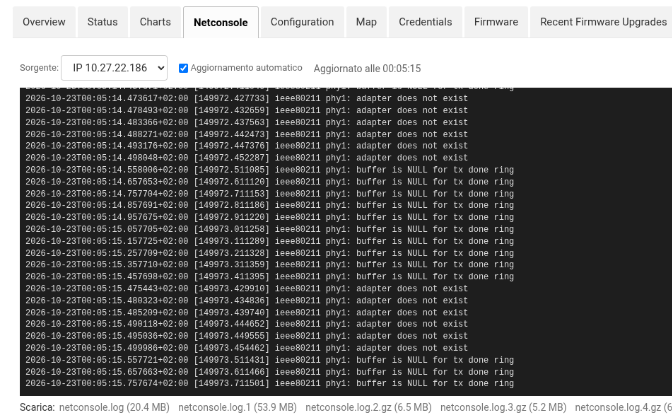
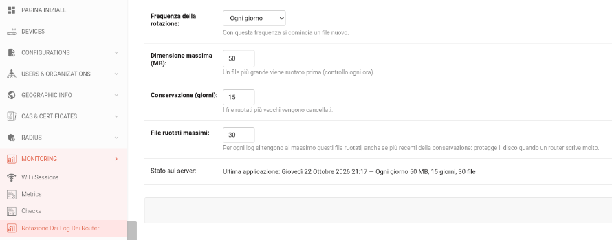

# openwisp-netconsole

[🇬🇧 English](README.md) | 🇮🇹 Italiano

> 📖 Questo repository fa parte dell'infrastruttura di **NINUX Basilicata**: la guida per ricostruirla tutta, passo passo (Proxmox, DNS, OpenWISP, moduli, firmware, app), è su **[GitHub Pages](https://mikysal78.github.io/ninux-basilicata-infra/)**.

[](https://github.com/mikysal78/openwisp-netconsole/actions/workflows/ci.yml)

Scheda **Netconsole** nella pagina del device di [OpenWISP](https://openwisp.org/):
mostra in tempo reale i messaggi del kernel che il router invia con
[netconsole](https://docs.kernel.org/networking/netconsole.html) e salvati sul
server da rsyslog. Serve soprattutto per i blocchi e i kernel panic, quando il
syslog non fa in tempo a partire.

Nato per la rete [NINUX Basilicata](https://github.com/mikysal78/openwisp2),
dove i router mandano netconsole al server OpenWISP.

## Schermate

La scheda Netconsole di un Linksys WRT3200ACM il cui driver Wi-Fi (mwlwifi)
scrive un errore dieci volte al secondo; i file ruotati sono elencati per
scaricarli (`netconsole.log.1` è stato ruotato a 50 MB):



La pagina di rotazione dei log dei router (solo superuser), con l'esito
dell'ultima applicazione sul server:



## Come funziona

```
router (netconsole, formato esteso + userdata ninux_node=<nome>)
   │ UDP 6666
   ▼
rsyslog  ──►  <LOG_DIR>/netconsole-<nome del device>/netconsole.log
              <LOG_DIR>/netconsole-<ip sorgente>/netconsole.log   (messaggi senza nome)
   ▲
   │ sola lettura
OpenWISP: scheda «Netconsole» del device
```

- La scheda mostra la cartella con il nome del device e quelle con il suo IP di
  gestione e il suo ultimo IP.
- Chiede al server solo le righe nuove ogni pochi secondi, mentre la scheda è
  aperta e la pagina è visibile.
- Elenca i file ruotati (`netconsole.log.1`, `.gz`…) per scaricarli.
- Si aggiunge all'admin del device già registrato (anche quello di
  openwisp-monitoring) senza sostituirlo.

## Installazione

Dalla [release](https://github.com/mikysal78/openwisp-netconsole/releases)
(wheel già compilato, con `SHA256SUMS`):

```bash
pip install https://github.com/mikysal78/openwisp-netconsole/releases/download/v0.2.1/openwisp_netconsole-0.2.1-py3-none-any.whl
```

oppure dal tag git:

```bash
pip install "openwisp-netconsole @ git+https://github.com/mikysal78/openwisp-netconsole@v0.2.1"
```

In `settings.py`, **dopo** `openwisp_controller.config` e
`openwisp_monitoring.device`:

```python
INSTALLED_APPS += ["openwisp_netconsole"]
```

Poi `collectstatic` e riavvio di OpenWISP. Con il ruolo
[ansible-openwisp2](https://github.com/openwisp/ansible-openwisp2):
`openwisp2_extra_python_packages` e `openwisp2_extra_django_apps`.

L'utente con cui gira OpenWISP (es. `www-data`) deve poter **leggere** la
directory dei log: conviene un gruppo dedicato, non `adm`.

### Playbook di esempio

Un playbook di base con il ruolo ufficiale
[ansible-openwisp2](https://github.com/openwisp/ansible-openwisp2) e il ruolo
di esempio [`router_logs`](examples/ansible/roles/router_logs/), che prepara il
lato server: rsyslog, il gruppo `router-logs` in sola lettura, lo script di
rotazione di root e il suo cron.

```bash
ansible-galaxy role install openwisp.openwisp2
cd examples/ansible
ansible-playbook -i hosts playbook.yml
```

```yaml
---
# Basic example: OpenWISP with openwisp-netconsole.
#
#   ansible-galaxy role install openwisp.openwisp2
#   ansible-playbook -i hosts playbook.yml
#
# router_logs (roles/ next to this file) sets up the server side:
# rsyslog, read-only access for OpenWISP, rotation managed from the admin
# page. All its variables are in roles/router_logs/defaults/main.yml.

- name: OpenWISP with openwisp-netconsole
  hosts: openwisp2
  become: true
  roles:
    - openwisp.openwisp2
    - router_logs
  vars:
    openwisp2_extra_python_packages:
      - "openwisp-netconsole @ https://github.com/mikysal78/openwisp-netconsole/releases/download/v0.2.1/openwisp_netconsole-0.2.1-py3-none-any.whl"
    openwisp2_extra_django_apps:
      - openwisp_netconsole
    # facoltativo: API per le app come openwisp-android
    openwisp2_extra_urls:
      - 'path("api/v1/", include("openwisp_netconsole.api_urls"))'
    # Optional, see the role defaults:
    # router_logs_retention_days: 15
```

Le variabili di `router_logs` e i loro valori predefiniti sono in
[`defaults/main.yml`](examples/ansible/roles/router_logs/defaults/main.yml);
di solito non serve cambiarne nessuna:

| Variabile | Predefinito | Significato |
|---|---|---|
| `router_logs_dir` | `/opt/router-logs` | dove rsyslog salva i log |
| `router_logs_group` | `router-logs` | gruppo in sola lettura per OpenWISP |
| `router_logs_openwisp_user` | `www-data` | utente con cui gira OpenWISP |
| `router_logs_syslog_port` / `router_logs_netconsole_port` | `514` / `6666` | ingressi UDP |
| `router_logs_frequency`, `_max_size_mb`, `_retention_days`, `_max_files` | `daily`, `50`, `30`, `30` | valori di partenza della rotazione |

La CI lo controlla con `--syntax-check`, `ansible-lint` (profilo production) e
`rsyslogd -N1`, e prova lo script di rotazione contro iniezioni, symlink e
FIFO. Poi limitate con il firewall chi può inviare su UDP 514/6666.

### Template per i device (lato router)

[`examples/openwisp-template/netconsole.json`](examples/openwisp-template/netconsole.json)
è un template OpenWISP che installa sui router uno script di hotplug
([`30-netconsole.sh`](examples/openwisp-template/30-netconsole.sh)). A ogni
`ifup`:

- trova la strada verso il server e il MAC del prossimo hop;
- carica netconsole in formato esteso (`+`), ricaricandolo solo se cambiano i
  parametri o l'interfaccia;
- aggiunge l'userdata `ninux_node` con il nome del device (`{{ name }}`,
  ricontrollato dallo script), che rsyslog usa per la cartella.

Per importarlo in OpenWISP: **Templates → Add**, backend OpenWRT, type
Generic, il contenuto di `config` nell'editor avanzato e `default_values` in
**Configuration variables**. Poi assegnatelo ai device.

| Variabile | Predefinito | Significato |
|---|---|---|
| `netconsole_server` | `192.0.2.10` (esempio) | IPv4 del server con rsyslog |
| `netconsole_port` | `6666` | porta UDP dell'ingresso netconsole |

Requisiti del firmware:

- `kmod-netconsole` (e il supporto netpoll nel kernel);
- per il nome del device, un kernel con `CONFIG_NETCONSOLE_DYNAMIC=y` e
  `kmod-fs-configfs`. OpenWrt compila kmod-netconsole con `=n`
  (`package/kernel/linux/modules/netsupport.mk`), quindi va cambiato nella
  vostra build. Senza, i messaggi arrivano lo stesso, nella cartella con l'IP
  sorgente.

La CI controlla lo script con `shellcheck` e genera il template con
netjsonconfig.

## API per le app

Le app come [openwisp-android](https://github.com/mikysal78/openwisp-android)
leggono le ultime righe dei log con il token delle API di OpenWISP
dell'utente, dopo aver aggiunto
`path("api/v1/", include("openwisp_netconsole.api_urls"))` alle URL del
progetto:

```
GET /api/v1/netconsole/device/<uuid del device>/logs/?lines=200
Authorization: Bearer <token da /api/v1/users/token/>

200 [{"kind": "name", "key": "C2600", "lines": ["...", "..."]}]
```

I controlli sono quelli della scheda e i log sono gli stessi (mai un percorso
dal client). `lines` va da 1 a `OPENWISP_NETCONSOLE_MAX_LINES` (default 1000; 200 se manca).
L'API accetta solo il token Bearer, mai la sessione del browser. Risposte:
`401` token mancante o non valido, `404` device inesistente o non consentito
(i due casi non si distinguono).

## Sicurezza

- **Accesso:** le viste sono dentro l'admin. Servono un utente staff
  autenticato, un device del queryset dell'utente (filtrato per
  organizzazione) e il permesso di vederlo. Altrimenti la risposta è 404.
- **Percorsi:**
  - il client non passa mai un percorso: sceglie una delle chiavi calcolate
    dal server (nome e IP del device) e uno dei file elencati;
  - chiavi e nomi dei file sono ricontrollati con espressioni regolari;
  - la cartella deve essere una directory reale dentro la radice, quindi i
    symlink sono scartati, e i file si aprono con `O_NOFOLLOW`.
- **Log di altri device:** il nome di un device in OpenWISP non è univoco, e
  un IP può passare da un router a un altro. Una chiave condivisa con un altro
  device, anche di un'altra organizzazione, non viene mostrata. Un nome che è
  esso stesso un IP viene ignorato.
- **XSS:** il testo dei log arriva come JSON e la pagina lo inserisce con
  `textContent`, mai come HTML.
- **Carico:** ogni richiesta legge al massimo `MAX_BYTES` byte e la pagina
  tiene al massimo 5000 righe. Le viste sono solo GET e non modificano nulla.
- **Rotazione:**
  - chi prendesse il controllo di OpenWISP potrebbe solo scegliere valori
    negli intervalli della tabella: non può riempire il disco né far sparire i
    log in poche ore;
  - lo script di root legge il JSON senza seguire symlink, solo se è un file
    regolare di al massimo 4 KB;
  - nella configurazione di logrotate entrano solo numeri interi e una delle
    tre frequenze ammesse. Con un valore non valido usa quelli del playbook e
    lo segnala nell'esito.
- **Limite noto:** il nome nell'userdata lo dichiara il router. Chi può
  mandare UDP alla porta di netconsole può scrivere righe nella cartella di un
  altro nodo. Limitate le sorgenti con il firewall e considerate questi log
  come diagnostica, non come prova.

## Sviluppo

```bash
pip install pytest
pytest
```

I test coprono la lettura dei file (`logfiles.py`), compresi i tentativi di
uscire dalla directory dei log, e le impostazioni di rotazione (`rotation.py`).

GitHub Actions: **CI** (a ogni push e pull request) esegue ruff, i test con
Python 3.10–3.13, il controllo che le migrazioni corrispondano ai modelli, i
controlli su JavaScript e traduzione, e compila il pacchetto verificandone il
contenuto. **Release** (a ogni tag `v*`) controlla che il tag corrisponda alla
versione, compila wheel e sdist e li allega alla release di GitHub con
`SHA256SUMS`.

## Segnalare vulnerabilità

Vedi [SECURITY.md](SECURITY.md): segnalazione privata tramite GitHub, advisory
di sicurezza e CVE per i problemi confermati. Sul repository sono attivi gli
avvisi Dependabot, la scansione dei segreti, CodeQL e `pip-audit` (nella CI).

## Licenza

GPL-3.0-or-later, come openwisp-controller.
